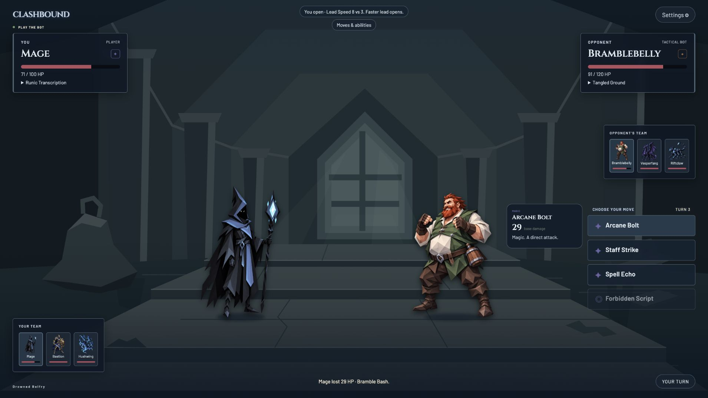
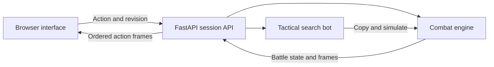

# Clashbound

A duo computer-science portfolio project: a browser-based, turn-based game
against a tactical bot. Pick three of ten characters, customise their moves,
and use type matchups and signature abilities to win.

## Project at a glance

**Stack:** Python / FastAPI backend; JavaScript, HTML and CSS frontend.
**Mode:** single player against a deterministic tactical bot.
**Demo:** [Play Clashbound](https://clashbound.onrender.com/) (free Render instance; initial loading may take a minute).

## My contribution and current focus

I proposed the game and, in our two-person team, focused on the browser
interface, tactical bot, gameplay decisions and testing. Abijeason mainly
built the core combat engine and also worked on art and presentation. We
reviewed and integrated each other's work; this is a shared project.

The bot's [search code](backend/bot/search.py) simulates legal actions using
the same engine as live matches. I tested its decisions with seeded team
matchups and baseline opponents; the [evaluation notes](docs/evaluation/BOT_EVALUATION.md)
show both strengths and remaining weaknesses. I also worked on move choice,
character identity and replayability. The character-motion work in
[PR #31](https://github.com/Zain-ux-lab/Clashbound/pull/31) is a standalone
review prototype for Abi, **not part of the playable battle screen**.

I am now more interested in improving the game from human playtests than in
claiming it is finished. The next evidence to add here is a short gameplay
recording and a dated playtest note showing a specific issue, the change we
made and the result.



*The playable battle interface with the approved Shadow Theatre character art.*

## Architecture



The server owns battle outcomes. The browser presents returned action frames,
including move effects and HP changes. The bot uses the same engine to evaluate
legal actions without mutating the live match. Matches are stored in memory;
a restart clears them.

See the [CV and interview pack](docs/CV_AND_PORTFOLIO.md) for a concise project
entry, engineering evidence, a demo walkthrough and interview preparation.

## Character abilities and opening Speed

Humans and creatures form mixed Accord teams in a world shaped by the Fracture.
The lore gives future arena interactions a foundation; arenas are currently visual only.
Opening Speed compares the locked starting characters, then total team Speed on a tie. Only an exact tie uses an equal draw. Veyne receives +3 lead Speed. Normal turns still alternate.

Every character has an automatic passive and a distinctive fourth move. Targeted moves let players choose a reserve character or predict an enemy move. The engine validates the same choices for the player and bot. All eight move options are available immediately: there are no mastery points, unlock gates or earned cosmetics. Old progress records are left untouched and unused.

See the [battle guide](frontend/guide.html) for player explanations and [mechanics handoff](docs/CHARACTER_MECHANICS.md) for implementation details.

## Team

- **Zain** — original concept, gameplay design, interface, tactical bot, character balance, and contributions to combat-engine and API integration.
- **Abijeason** — core combat engine, artwork, menus/settings, music and presentation.

We both contributed across boundaries; these lines describe each person's main focus.

We review each other's changes through pull requests and share responsibility
for integration and understanding the code. AI assists development; changes
are tested and reviewed. The animated homepage, character introductions and
homepage sound controls are included; further interface polish remains in progress.

## Playable features

- Three-character teams; the bot randomly draws three different characters.
- One active character and one action per turn.
- Each character has two fixed signature moves and two selectable moves from
  six alternatives. Selections lock before combat. The bot gets legal builds too.
- HP, Power, Focus, Armour, Ward, Recovery and opening Speed vary by character.
- Physical moves scale with Power against Armour. Magic/Elemental/Spirit moves use Focus
  against Ward. Contact is a separate property. Healing scales with Recovery.
- Magic beats Elemental; Elemental beats Physical; Physical beats Spirit; Spirit beats Magic. Opposite types are neutral.
  Strong attacks deal 125%, resisted attacks 80%, same-type attacks 100%.
- Deterministic statuses, healing, lifesteal, guard, delayed damage and counters.
- Switching costs a turn and clears effects; knockout replacements are free.
- Tactical bot searches its action and an opponent reply, then evaluates surviving characters, HP,
  pending effects and active damage matchups. It uses the same engine as the API.
- Ten approved Shadow Theatre character sprites and the Drowned Belfry visual stage.
  The earlier arena catalog remains available as concept art; the current battle UI uses the Belfry.
- Move details show base damage. Attack announcements and floating HP changes
  show outcomes; type symbols have accessible names and hover labels.

Effect applications are logged. Both active characters show status labels and
remaining actions beside HP; opening them explains each effect. Confused moves
show a recoil warning. Hidden buffs, crit randomness, progression and online
multiplayer are not implemented. Artwork is static with CSS combat animations.
Balance is provisional and needs human playtesting.

## Run locally

From the cloned repository:

```bash
python3 -m venv .venv
source .venv/bin/activate
python -m pip install -r requirements.txt
python -m uvicorn backend.main:app
```

Open http://127.0.0.1:8000/ and select **Play now** to enter the battle screen.
Character introductions are at `/characters.html`. Keep the terminal running;
Control+C stops it.
Do not enable automatic reload while playing: battles live in one server process
and disappear on restart. Sessions expire after 30 minutes of inactivity.
Use one worker. Accounts, persistent saves and a shared production store are
not implemented.

## Verify

```bash
python -m pytest -q
node --test tests/test_*.cjs
```

Python tests cover engine effects, type/stat scaling, legal actions, bot decisions,
API isolation/revisions, move selection and arena persistence. Node tests cover
client connection recovery, move details and turn input locking.

## Code map

- `backend/engine/` — creatures, moves, stat/type damage and turn resolution.
- `backend/roster.py` — character stats, signature moves and selectable pools.
- `backend/bot/` — legal-action simulation and deterministic lookahead.
- `backend/api/routes.py` — authoritative browser sessions and battle snapshots.
- `backend/arenas.py` — visual-only arena catalog.
- `frontend/` — selection, battle screen, CSS effects and original PNG assets.
- `tests/` — gameplay and browser-facing regression checks.

See [battle rules](BATTLE_RULES.txt), [UI integration notes](docs/GAMEPLAY_UI_HANDOFF.md),
[character artwork](docs/CHARACTER_ART.md) and [arena artwork](docs/ARENA_ART.md).

## Collaboration

Pull the latest shared branch before starting, make changes on a feature branch,
run relevant checks, and open a PR with behaviour and validation clearly stated.
A teammate reviews before merge. Coordinate edits to shared API/frontend files
in the PR; do not overwrite someone else's uncommitted work.

## Portfolio focus

Shared combat simulation, deterministic AI search, state management, API validation,
regression testing, measured playtests and a professional two-person Git workflow.
The earlier multiplayer/database scaffold is historical, not a claim of shipped
networking or database functionality.

## Bot evaluation

The reproducible [bot evaluation](docs/evaluation/BOT_EVALUATION.md) compares the
tactical bot against random and immediate-damage opponents using matched teams
and both starting positions. The first 80-game sample found 92.5% wins against
random but only 47.5% against damage-only; AI strength remains a work in progress.

```bash
python -m backend.bot.evaluation --fixtures 20 --seed 20261007 --output /tmp/bot-results.json
```

The [matchup-scoring experiment](docs/evaluation/MATCHUP_SCORING.md) adds earlier
beneficial switching and reports before/after results. Damage-only wins reached
50% on both original and fresh teams, with a small regression against random;
these are preliminary results, not evidence of human-level play.
